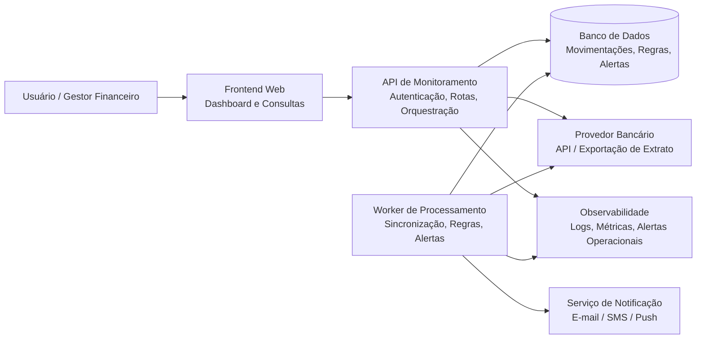
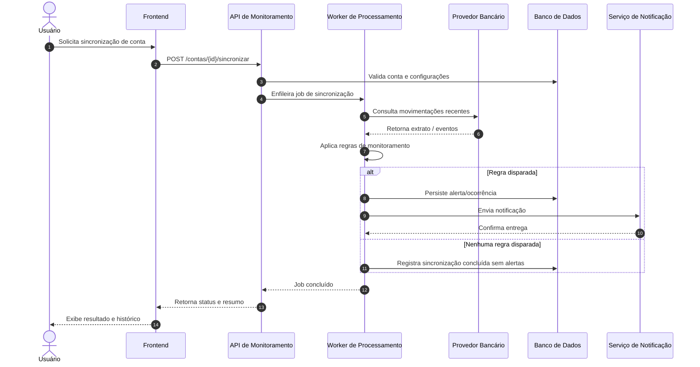

# Monitoração Bancária — Base de Documentation Discovery

## 1) Contexto do sistema

Este repositório concentra uma pequena fase de discovery de documentação para um sistema de monitoramento bancário voltado a usuários e equipes que precisam acompanhar contas, movimentações e eventos financeiros com maior consistência e menor esforço manual.

### Visão do problema

O sistema proposto tem como objetivo:
- centralizar a leitura de movimentações bancárias em uma interface única;
- detectar eventos relevantes, como entradas, saídas, saldos críticos ou movimentações atípicas;
- gerar alertas e notificações automáticas para usuários ou responsáveis;
- permitir acompanhamento histórico de ocorrências e apoio à análise de despesas ou recebimentos.

### Escopo

- Usuários finais: pessoa física, gestor financeiro ou suporte operacional;
- Fluxo principal: autenticação, sincronização de movimentações, regras de monitoramento, alertas, consulta de histórico;
- Dados de entrada: extrato bancário, movimentações recentes, saldos e eventos de integração;
- Dados de saída: dashboards, alertas por e-mail/WhatsApp/Push e registros de auditoria.

### Níveis de visão

- Visão de contexto: usuários, sistema financeiro, canais de notificação e provedor bancário;
- Visão de containers: frontend, API, worker de processamento, banco de dados, serviços externos e observabilidade;
- Visão comportamental: jornada crítica de sincronização e alerta.

## 2) Definição de responsabilidades, limites e integrações

### Responsabilidades do sistema

- Coletar movimentações bancárias por integração ou importação;
- aplicar regras configuráveis de monitoramento (ex.: saldo abaixo do mínimo, recebimento de valor alto, saídas repetidas);
- registrar eventos e gerar alertas;
- disponibilizar consultas e relatórios de acompanhamento;
- manter rastreabilidade para suporte e auditoria.

### Limites do sistema

- Não é um sistema bancário oficial, nem substitui o ambiente do banco ou do provedor financeiro;
- assume que a instituição financeira oferece alguma API ou mecanismo de exportação segura;
- não contempla cobrança, conciliação contábil completa ou suporte a múltiplas moedas em profundidade;
- não prevê decisões automáticas de pagamento ou aprovação de transações.

### Integrações esperadas

- Provedor bancário ou API de extrato;
- serviço de notificação (e-mail, SMS, WhatsApp ou push);
- autenticação/identidade corporativa ou de usuário;
- armazenamento persistente para movimentações, regras, alertas e auditoria;
- observabilidade e logs para diagnóstico.

### Restrições e lacunas

- Não há definição detalhada de RBAC para perfis de usuário;
- não foi especificado a política de retenção de dados e confidencialidade;
- a estratégia de sincronização é assumida como periódica, com baixa latência, mas sem SLA formal;
- o modelo não define ainda contratos de mensagens entre serviços;
- ainda falta detalhar o processo de reconciliação em caso de falhas de sincronização.

## 3) Diagrama estrutural (Mermaid)

A seguir, um diagrama estrutural em estilo inspirado em C4/containers, representando o sistema de monitoramento bancário.

### Ajustes e decisões aplicados

- Optei por representar o processo como uma arquitetura modular, com um frontend, uma API, um worker assíncrono e um banco de dados.
- O worker foi separado da API para refletir a necessidade de processamento em lote e execução assíncrita de regras.
- A observabilidade foi incluída como parte estrutural, porque documentação de arquitetura útil para agentes deve explicitar como diagnosticar falhas e monitorar integridade.

## 4) Diagrama comportamental (Mermaid)

A seguir, uma jornada crítica: o usuário solicita a sincronização de uma conta, o sistema consulta o provedor bancário, aplica regras de análise e dispara notificação se houver condição relevante.

## 5) Decisões, ajustes e observações importantes

### O que o modelo inferiu corretamente

- A estrutura central de um sistema de monitoramento financeiro é plausível e consistente.
- A separação entre API e worker é uma decisão natural para sistemas com processamento assíncrono.
- O fluxo de sequência com sincronização, regras e notificação está alinhado com o comportamento esperado.

### O que foi ajustado manualmente

- Reforcei o papel do worker como componente separado, em vez de deixar a API responsável por tudo.
- Explicitamente incluí observabilidade e armazenamento de auditoria, porque isso aumenta a utilidade da documentação para agentes e mantenedores.
- Defini limites bem claros para evitar que a arquitetura pareça um sistema bancário completo ou um sistema financeiro de missão crítica.
- Ajustei a terminologia para deixar o documento mais claro e menos ambíguo para uma implementação futura.

### O que a documentação precisaria ter a mais para um agente construir o sistema sem inventar decisões

Para que um agente possa implementar o sistema com aderência à arquitetura documentada, faltariam ainda estes itens:

1. Contratos de API explícitos (request/response, status codes, erros padronizados);
2. Definição de modelos de dados (entidades principais, campos, regras de negócio, enumerações);
3. Regras de autenticação e autorização por perfil;
4. Estratégias de retenção, mascaramento e criptografia dos dados sensíveis;
5. Padrões de observabilidade (logs estruturados, métricas, traces e alertas operacionais);
6. Critérios de resiliência (retries, fila de processamento, dead-letter, idempotência);
7. Definição de integrações externas reais (provedor, canal de notificação, ambiente de autenticação);
8. Backlog de arquitetura ou decisão de ADRs para requisitos de alta criticidade.

## 6) Como este repositório pode servir como base para agentes de desenvolvimento

Este repositório foi organizado como uma base de discovery e contextualização para um futuro agente de desenvolvimento. Em vez de apenas descrever a solução em linguagem natural, ele tenta deixar explícitos:

- o que o sistema faz;
- onde ele se encaixa no contexto de negócio;
- como os componentes principais se relacionam;
- quais decisões foram assumidas;
- quais pontos ainda precisam ser definidos antes da implementação.

Esse formato é útil para orientar geração de código, revisão de arquitetura e alinhamento entre pessoas e ferramentas.

## 7) Sugestão de próximos passos

- Adicionar um arquivo com contratos de API em OpenAPI;
- incluir diagramas de dados e de implantação;
- detalhar os requisitos de segurança e privacidade;
- registrar decisões arquiteturais em ADRs;
- transformar a base em contexto para agentes com prompts e metas mais estruturadas.
